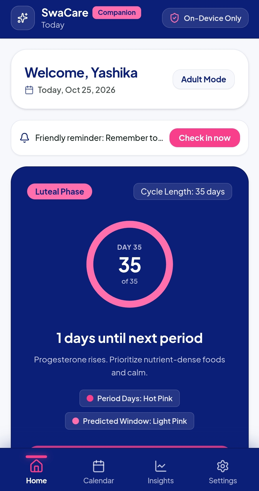
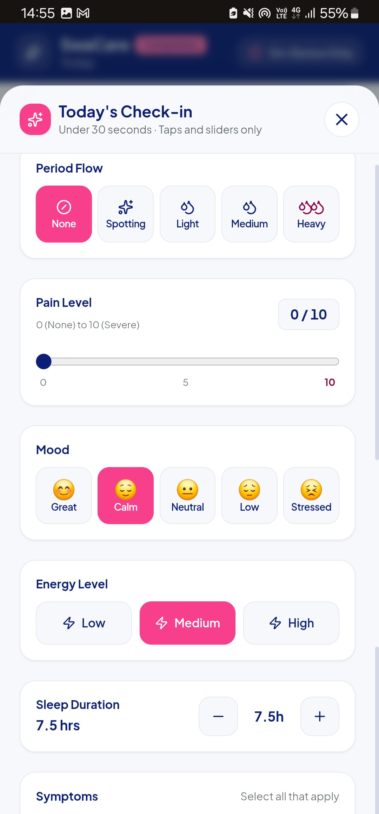
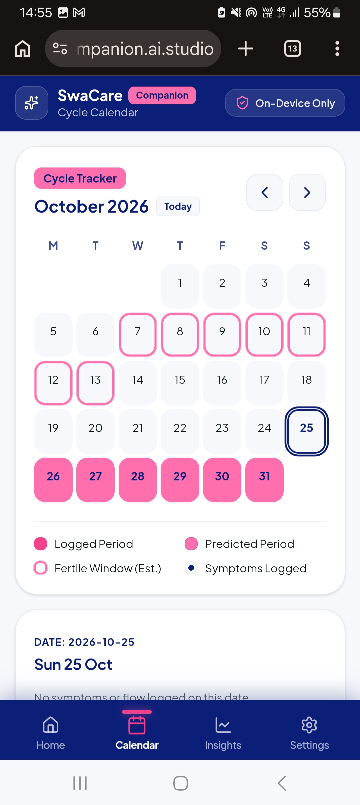
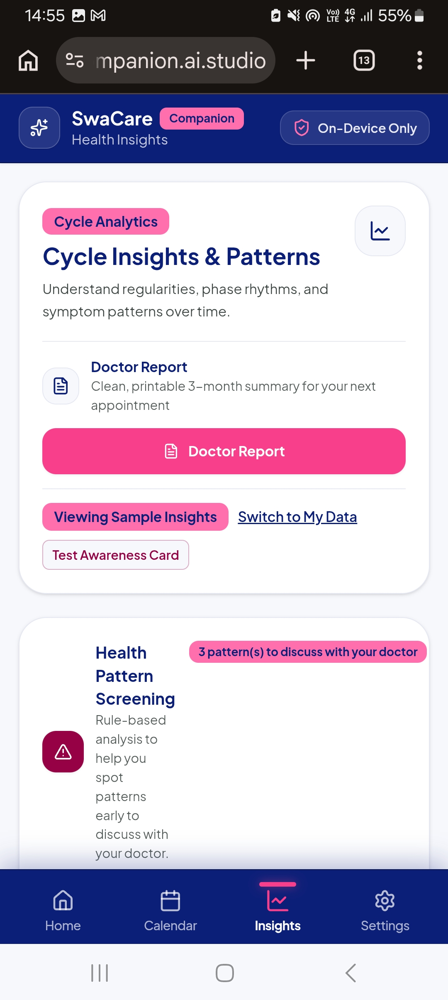
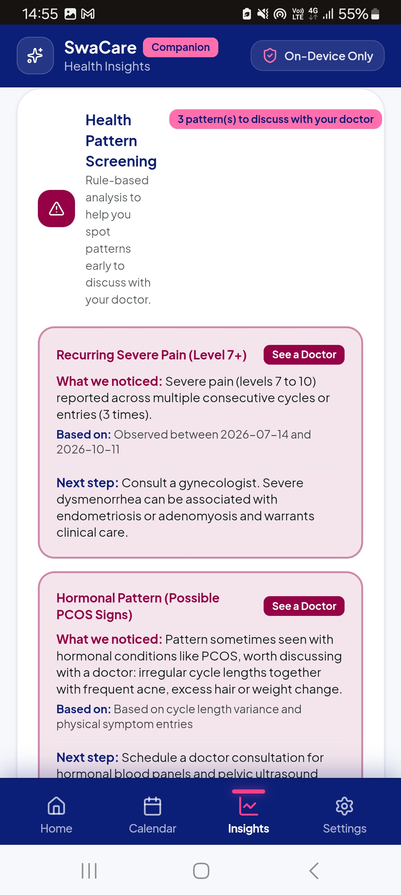
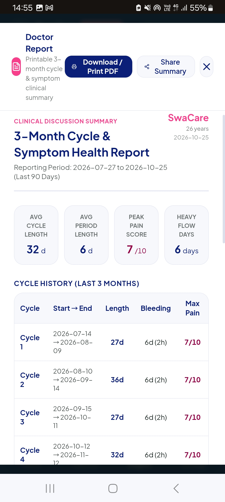

# SwaCare

**Track. Understand. Act.**


SwaCare is a women's health companion that helps women understand their bodies, spot patterns early, and walk into a doctor's office with real data. *Swa* (स्व) means "self": care that stays in a woman's own hands.

> **Disclaimer:** SwaCare helps you track and understand patterns from self-reported data. It does **not** diagnose any condition and is not a substitute for professional medical advice. Always consult a qualified doctor about health concerns.

---

## Table of Contents

- [Demo and Screenshots](#demo-and-screenshots)
- [The Problem](#the-problem)
- [Our Solution](#our-solution)
- [Key Features](#key-features)
- [How It Empowers Women](#how-it-empowers-women)
- [Health Pattern Screening](#health-pattern-screening)
- [Languages](#languages)
- [Privacy and Safety](#privacy-and-safety)
- [Design System](#design-system)
- [Tech Stack](#tech-stack)
- [Getting Started](#getting-started)
- [Project Structure](#project-structure)
- [Roadmap](#roadmap)
- [Contributing](#contributing)
- [License](#license)

---

## Screenshots

| Home | Daily Check-in | Calendar |
|:---:|:---:|:---:|
|  |  |  |

| Insights | Screening | Doctor Report |
|:---:|:---:|:---:|
|  |  |  |

---

## The Problem

Many women live with irregular periods, severe pain, or heavy bleeding and are told, or assume, that it is "normal." When they finally see a doctor, they often have no record to show: no dates, no patterns, no history. This contributes to:

- **Gaps in diagnosis**: conditions such as PCOS, thyroid disorders, anemia, and endometriosis are noticed late.
- **Weak symptom tracking**: most women rely on memory.
- **Low health awareness**: myths and silence around women's health persist.
- **Limited access to clinical insights**: especially for women who do not use English-language apps.

## Our Solution

SwaCare turns everyday symptom logging into early awareness and better consultations:

**Daily check-in → Pattern detection → Doctor-ready report**

1. **Track** symptoms and cycles in under 30 seconds a day.
2. **Understand** patterns through simple graphs and plain-language insights.
3. **Act** early: get a clear "worth discussing with a doctor" flag and a one-page report to take along.

## Key Features

### Core
- **Daily symptom check-in**: flow, pain (0-10), mood, energy, sleep, and symptoms (cramps, headache, bloating, acne, hair fall, fatigue, and more), all with taps and sliders.
- **Cycle tracker and calendar**: logged period days, predicted next period, and estimated fertile window.
- **Insights dashboard**: cycle length trends, period duration and flow, pain trends, and mood/energy/sleep patterns by cycle phase.
- **Health pattern screening**: rule-based early-warning flags (see below).
- **Doctor report**: a printable one-page summary of the last three months.

### Women-specific personalisation
- **Life-stage modes**: Teen, Adult, Pregnancy, and Perimenopause, each with tailored fields and tips.
- **Cycle-phase wellness guide**: food, exercise, and energy tips for the current phase.
- **PMS and mood tracking**: see how mood and symptoms follow the cycle.
- **Myth-busting ("Know the facts")**: clear, correct answers to common myths.
- **Discreet mode**: neutral app name, hidden health wording in reminders, and PIN protection.

## How It Empowers Women

| Before | With SwaCare |
|---|---|
| "It's probably normal." | Data-based patterns and clear flags |
| Telling the doctor from memory | A ready report with dates and trends |
| Health information only in English | The app in her own language |
| Data held by someone else | Data stays on her device, under her control |

SwaCare gives women **knowledge, a voice, and control**, so they lead decisions about their own health.

## Health Pattern Screening

SwaCare's screening engine is **rule-based** and **never diagnoses**. It highlights patterns that may deserve medical attention, for example:

- Cycles shorter than 21 or longer than 35 days, repeated across recent cycles
- No period for 90 or more days
- Heavy flow lasting more than 7 days
- High pain (7+) across several consecutive cycles
- Irregular cycles together with frequent acne, excess hair growth, or weight change
- Persistent fatigue together with heavy flow (worth checking iron levels)

Each flag explains what was noticed, which dates or cycles it is based on, and a suggested next step. Flags that need attention are shown in crimson with the message *"This pattern is worth discussing with a doctor."*

> The thresholds above should be validated against current clinical guidance (for example ACOG, WHO, ICMR) and reviewed by a medical professional before any real-world release.

For emergency signs (very heavy bleeding, severe pain, pregnancy-related concerns), the app advises seeking medical care immediately.

## Languages

- English
- Hindi (हिन्दी)
- Hinglish (Hindi written in the Roman script, mixed with English)

All interface text lives in translation files, so adding a language means adding one file.

## Privacy and Safety

- **Data stays on the device** (browser local storage in the current version). No account or server is required.
- **PIN-based app lock** and **discreet mode** for privacy at home.
- **Export my data** (JSON) and **Delete all my data** at any time.
- Clear disclaimers: SwaCare screens and informs; it does not diagnose.

## Design System

| Role | Colour | Hex |
|---|---|---|
| Background | Cool off-white | `#F7F8FC` |
| Cards | White | `#FFFFFF` |
| Dark base (app bar, headings, hero card) | Navy | `#0C1F78` |
| Primary accent (main buttons, period days) | Hot pink | `#F73F8B` |
| Soft accent (chips, predictions) | Light pink | `#FF6FAE` |
| Alerts and "see a doctor" flags | Crimson | `#960045` |
| Text | Ink | `#0B1713` |
| Dividers | Light lavender-grey | `#E6E8F3` |

Proportion: roughly 60% neutral, 30% navy/ink, 10% pink and crimson accents. Pink is an accent, never a large background.

## Tech Stack

- **React** + **Tailwind CSS**: mobile-first responsive web app
- **Recharts**: charts for the insights dashboard
- **Browser localStorage**: private, on-device data storage
- **Google AI Studio (Build)**: used to generate and iterate on the app

## Getting Started

> The commands below assume a standard Node.js project (for example a Vite export). Adjust them to match your repository.

**Prerequisites:** Node.js 18 or later and npm.

```bash
# 1. Clone the repository
git clone <your-repo-url>
cd swacare

# 2. Install dependencies
npm install

# 3. Start the development server
npm run dev
```

Then open the local URL shown in your terminal (usually `http://localhost:5173`).

**Build for production**

```bash
npm run build
npm run preview
```

**Try it with demo data:** turn on *Demo data* in **Settings** to load six sample cycles, which also triggers example screening flags so every feature can be explored right away.

## Project Structure

A typical layout (yours may differ depending on how the project was exported):

```
swacare/
├── src/
│   ├── components/     # Reusable UI (cards, charts, check-in form, calendar)
│   ├── screens/        # Home, Calendar, Insights, Settings, Onboarding
│   ├── logic/          # Cycle prediction, screening rules, report builder
│   ├── i18n/           # Translation files (en, hi, hinglish)
│   ├── theme/          # Colour tokens and shared styles
│   └── App.jsx
├── public/
├── package.json
└── README.md
```

## Roadmap

**Next**
- Voice input for the daily check-in
- Notifications and reminders on mobile

**Later**
- Clinician / ASHA worker dashboard
- Teleconsultation and nearby clinic discovery
- Wearable integration
- ML-assisted pattern detection, validated with clinicians
- More regional languages
- Trusted-contact alerts for emergencies

## Contributing

Contributions are welcome, especially from clinicians, designers, and translators.

1. Fork the repository
2. Create a feature branch (`git checkout -b feature/your-feature`)
3. Commit your changes
4. Open a pull request describing what you changed and why

For any change to screening rules, please cite a clinical source in the pull request.

## License

Add your license here  and include a `LICENSE` file.

---

*SwaCare: because every woman deserves to understand her own health.*
